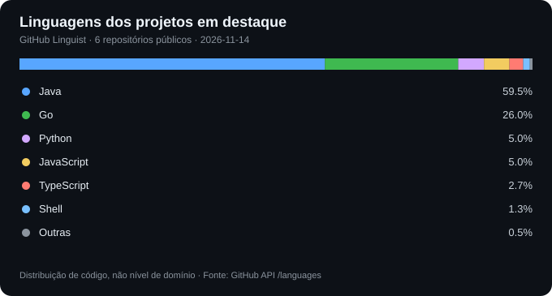

# Danilo Maciel

**Engenheiro de Software Sênior | Backend, Sistemas Distribuídos e Arquitetura de Software**

Desenvolvedor com cerca de 10 anos de experiência em construção e evolução de aplicações backend, mobile e web. Trabalho com **Java / Spring Boot, Go, Flutter** e integrações entre sistemas, com atenção a qualidade, segurança e manutenibilidade.

Na prática, atuo no desenvolvimento e na manutenção de sistemas: implementação de funcionalidades, integração de APIs, persistência de dados, correção de problemas e testes. Essa experiência orienta meu interesse crescente por decisões de arquitetura.

Meu foco de evolução profissional é **arquitetura de software e soluções**: entender requisitos, avaliar trade-offs e projetar sistemas que possam ser operados e evoluídos com segurança.

### Competências

- **Backend:** Java, Spring Boot, Go, APIs REST, autenticação e integração entre serviços.
- **Arquitetura:** arquitetura em camadas, Clean/Hexagonal Architecture, microsserviços, mensageria e modelagem C4.
- **Qualidade e operação:** testes automatizados, GitHub Actions, Docker, observabilidade e PostgreSQL.
- **Experiência complementar:** Flutter, Android, .NET e AWS.

### Projetos em destaque

Os projetos abaixo combinam exemplos de implementação, qualidade e análise arquitetural. Eles são **demonstrações técnicas e estudos**, não sistemas cuja operação em produção foi comprovada.

| Projeto | Evidências e decisões técnicas |
| --- | --- |
| **[Microsserviços Spring Boot](https://github.com/danmaciel/monorepo_sistema_todo_com_microservices)** | Gateway, Eureka, JWT e PostgreSQL; integração com Docker Compose e tracing OpenTelemetry/Zipkin. |
| **[API REST — Go](https://github.com/danmaciel/api)** | API de clientes, produtos e pedidos, com testes, diagramas C4 e estoque transacional. |
| **[Agendador — Java / Spring Boot](https://github.com/danmaciel/agendador_app_monorepo)** | Casos de uso, autorização JWT, migrações Flyway e testes em CI. |
| **[Arquitetura AWS — Estudo de caso](https://github.com/danmaciel/diagrama_arquitetura_escalavel_aws)** | Diagrama editável e análise de disponibilidade, segurança, custos e recuperação; **sem implantação comprovada**. |
| **[Rate Limiter — Go / Redis](https://github.com/danmaciel/rate_limite_golang)** | Middleware por IP/token com Redis e testes; limitações documentadas. |
| **[Arquitetura Hexagonal — TypeScript](https://github.com/danmaciel/arquitetura_hexagonal)** | Ports & adapters, casos de uso isolados e testes Jest. |

**Outros estudos com código e testes:** [Clean Architecture em Go](https://github.com/danmaciel/ca_golang) — casos de uso acessíveis por REST, GraphQL e gRPC, validação de pedidos, eventos locais e testes de concorrência. O RabbitMQ está disponível no Compose, mas **não faz parte do fluxo executado**. [Temperatura por CEP e OpenTelemetry](https://github.com/danmaciel/temperature_by_cep_with_telemetry) — comunicação entre dois serviços Go, propagação de traces, validação de respostas externas e teste de proteção da chave da WeatherAPI nos spans.

**Como avalio uma solução:** requisitos e restrições → decisões e trade-offs → implementação → testes e evidências → limites e possíveis evoluções.

### Formação e aprendizado contínuo

- Bacharelado em Ciência da Computação.
- Especialização em Go (GoExpert).
- Estudos em Arquitetura de Sistemas e Soluções com IA.

### Contato

[LinkedIn](https://www.linkedin.com/in/danilo-s-maciel/) · [GitHub](https://github.com/danmaciel)

### Linguagens dos projetos em destaque

Distribuição aproximada dos bytes de código identificados pelo GitHub Linguist nos seis projetos públicos da seção acima. Não representa experiência profissional ou nível de domínio. [Critérios e atualização semanal](./scripts/generate_portfolio_languages.py).
